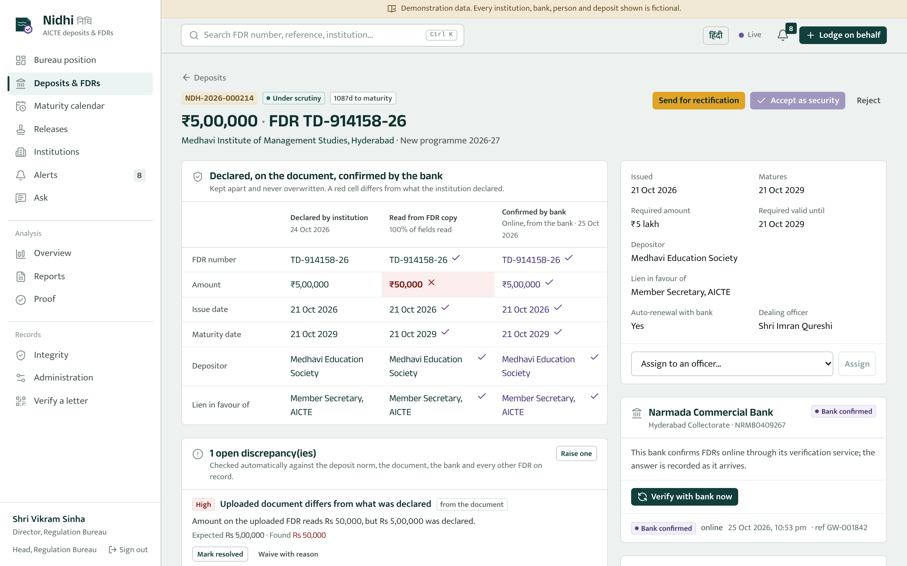
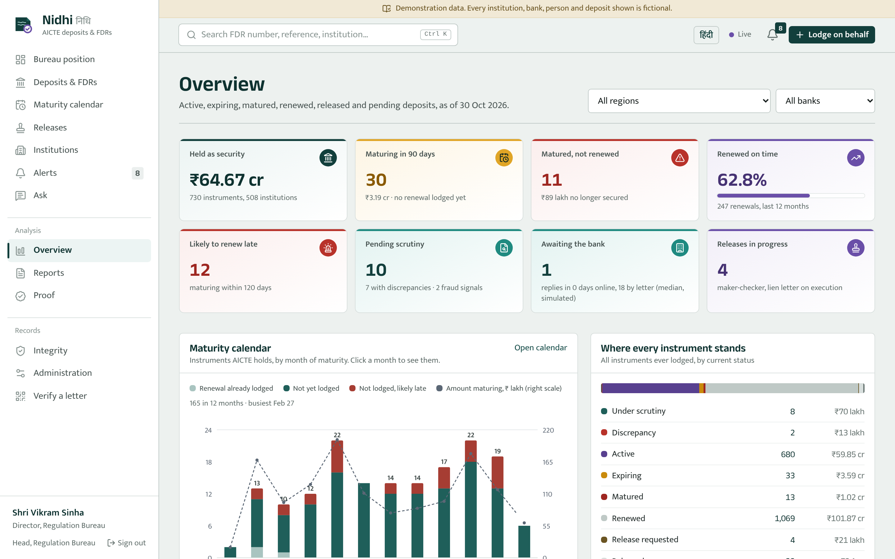
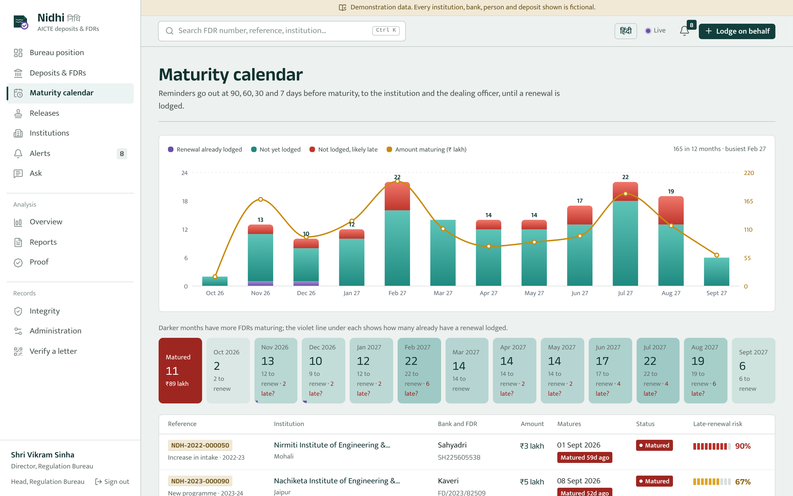
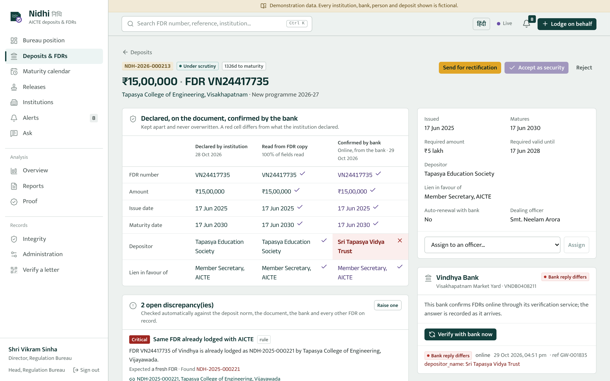
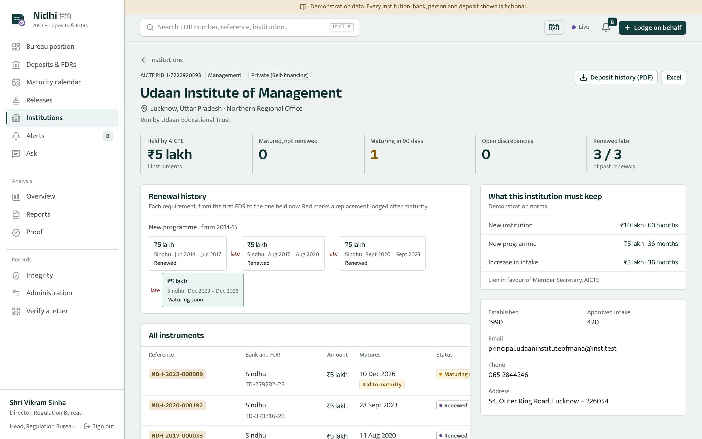
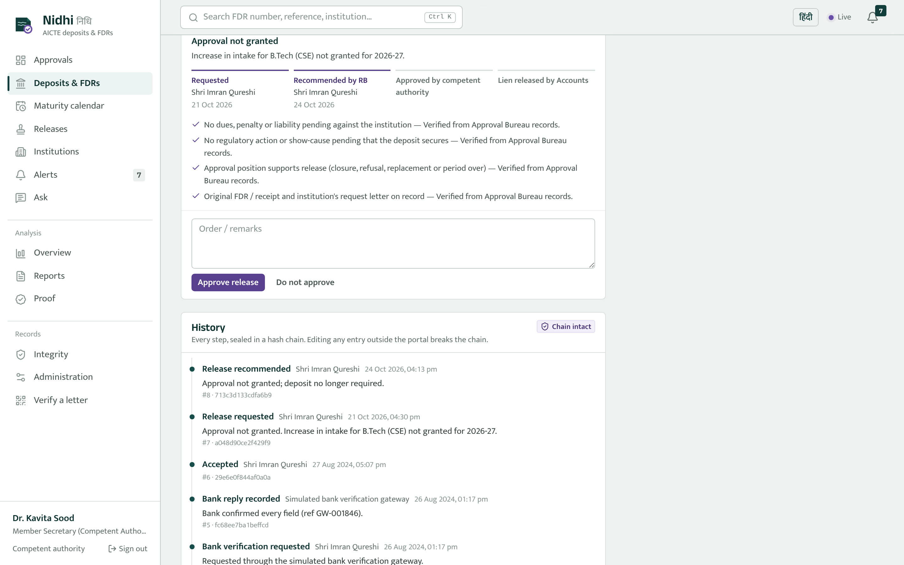
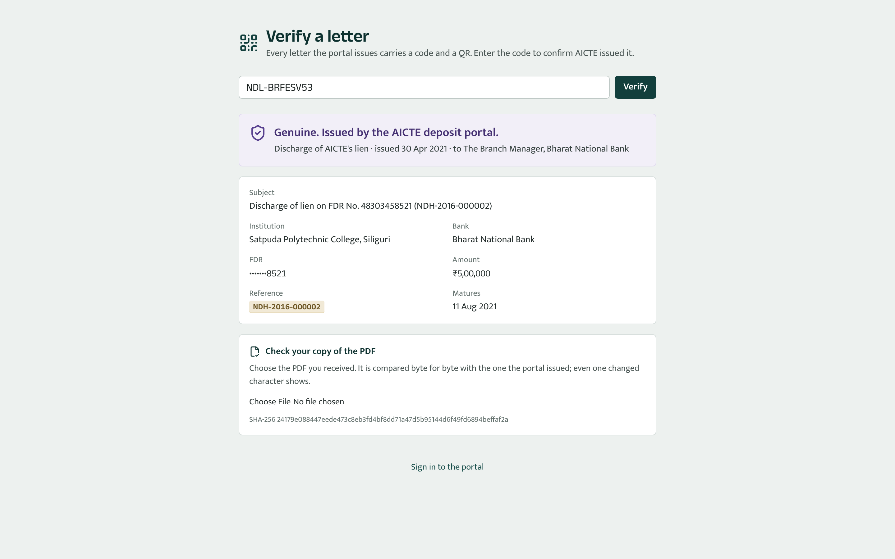
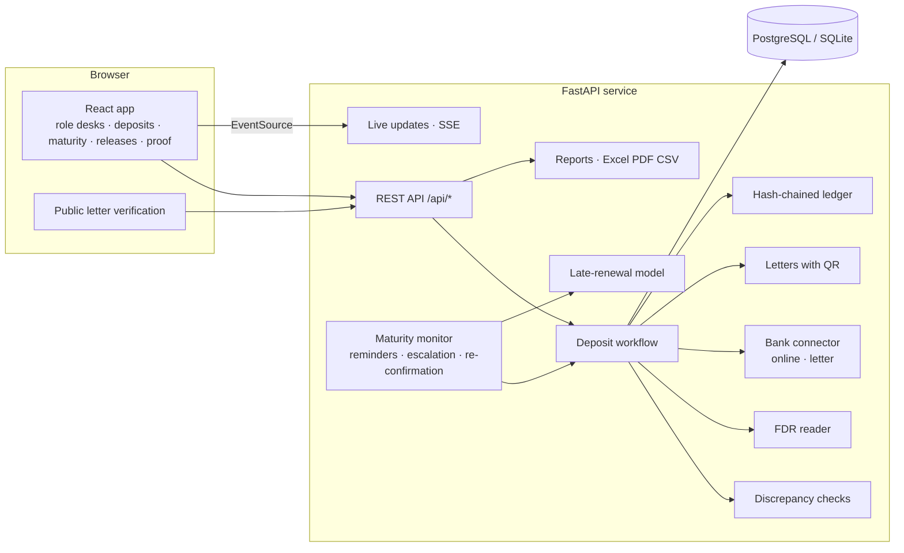

# Nidhi (निधि): every FDR pledged to AICTE, verified with the bank and never allowed to lapse

**Smart India Hackathon 2026 · Problem Statement 26265 · All India Council for Technical Education (AICTE) · Team SignalNine (198001)**

**Source:** [github.com/prag-x/Nidhi](https://github.com/prag-x/Nidhi)

*Nidhi* (निधि) means a fund held in trust.

AICTE asks institutions to keep security deposits or Fixed Deposit Receipts (FDRs) pledged to it as part of approval and compliance. Today these are tracked through files, letters to bank branches and spreadsheets. Nidhi is one portal for the whole life of a deposit, from the day an institution lodges it to the day AICTE releases its lien. It serves the Regulation Bureau, the competent authority, Finance & Accounts, the Regional Offices, audit and the institutions themselves. It does four things the paper process cannot:

- It **reads the FDR copy**, whether a PDF, a scan or a phone photo, and keeps what the institution declared, what the document says and what the bank confirmed **side by side, never merged**.
- It **catches problems the moment a deposit is lodged**: a short amount, a missing lien, an altered copy, or the same FDR pledged by two institutions.
- It **watches every maturity date**, reminds before it, escalates after it, and predicts who is likely to renew late.
- It **releases a deposit only by maker-checker**, ending in a lien-release letter that any bank can verify by its QR code.



> **The demo data is synthetic.** There are 600 fictional institutions, 11 fictional banks and about 1,850 deposits over ten years. Generated FDR copies carry the watermark *SYNTHETIC SPECIMEN – NOT A BANK DOCUMENT*. **Deposit amounts and tenures are demonstration values** that the administrator can change; they are not AICTE's norms. No real bank is contacted: verification runs through a simulated connector with the same interface a real one would have.

## Why this matters

The problem statement describes the current situation and what the portal must prove:

> "When these activities are managed through fragmented records, manual correspondence or multiple tracking mechanisms, it may become difficult to maintain an accurate and up-to-date view of deposit status, pending actions and time-sensitive requirements."

> "The system should distinguish between information submitted by an institution and information independently confirmed by an authorized bank or financial source."

> "The prototype should demonstrate measurable improvements in record accuracy, verification turnaround time, timely renewal monitoring, reduction in manual tracking effort and visibility into pending cases."

An FDR is security only while it is genuine, pledged to AICTE and unexpired. Each of those can fail silently on paper: a copy is altered, the lien is never marked, the receipt is closed at the branch, or it simply matures and nobody notices. Nidhi is built around catching each one.

## Where it fits

Nidhi does not replace the AICTE approval portal or a bank's systems. It sits between them, where deposits are checked, held and released.

| Today | What it does | What it does not do | With Nidhi |
|---|---|---|---|
| **Files, registers and spreadsheets** at the Regulation Bureau | Record what was received | Show what is held, what is maturing or what is pending across all institutions; detect an altered or reused FDR | One live register with status, maturity calendar, queues and 17 automatic checks |
| **Letters to bank branches** | Ask a branch to confirm an FDR | Track the reply, compare it with the declaration, or re-check later | Verification letters with QR codes; replies recorded against each field; online confirmation where a bank offers it; re-confirmation every 180 days |
| **File notings for release** | Record approvals | Enforce conditions or separate who recommends from who approves | Four conditions checked; RB recommends, competent authority approves, Accounts executes |
| **AICTE approval portal** | Collects the institution's application | Hold or monitor the deposit afterwards | Takes the application reference; reminders and escalation until renewal |

---

## What it does

### Everything the problem statement asks for

| # | Capability in PS 26265 | In Nidhi |
|---|---|---|
| 1 | **Centralised repository**, institution-wise and instrument-wise | Every deposit has a reference (`NDH-YYYY-NNNNNN`), bank, branch, IFSC, FDR number, amount, dates, depositor, lien, purpose and status. Institution pages show every deposit they have ever lodged, as renewal chains. |
| 2 | **Digital document management** | FDR copies (PDF, or a scan or photo as PNG/JPG), bank letters and other records are uploaded, type-checked against their contents, fingerprinted with SHA-256 and recorded in the deposit's history. The portal **reads the FDR copy**, by OCR for scans and photos, and pre-fills the form. |
| 3 | **Verification and discrepancy detection**, keeping institution-submitted and bank-confirmed information apart | The signature screen shows **what the institution declared, what its FDR copy says and what the bank confirmed**, field by field, never merged. 17 automatic checks, plus any an officer raises. Banks with an online service are asked through a pluggable connector; for the rest the portal writes a verification letter and the officer records the branch's reply. |
| 4 | **Automated validity and maturity tracking** with configurable reminders | A monitor moves each deposit to *maturing soon* and *matured*, and reminds the institution and the dealing officer at 90, 60, 30 and 7 days (configurable) until a renewal is lodged. |
| 5 | **Renewal and replacement monitoring** with history | A renewal points at the FDR it replaces. When accepted, the old one closes as *renewed*, marked on time or late. Institution pages draw each requirement's chain of FDRs over the years. |
| 6 | **Release and refund workflow** under the competent authority | Requested by the institution, checked against four conditions and recommended by the Regulation Bureau, approved by the competent authority, executed by Accounts with a **lien-release letter to the bank**. The approver can never be the person who recommended. |
| 7 | **Alerts and escalation** | Maturity reminders, matured-not-renewed, bank reply overdue, discrepancies, fraud signals, release steps, and **escalation to the RB head after 15 days and to the competent authority after 45** (configurable). Live in the browser; institutions get e-mail and SMS through an outbox. |
| 8 | **Dashboard and reports** | Overview of active, expiring, matured, renewed, released and pending deposits, a 12-month maturity calendar, bank-wise and region-wise positions. Eight reports, each in Excel, PDF and CSV, plus an institution deposit history. |
| 9 | **Audit trail and access control** | Eight roles; institutions see only their own deposits. Every action is in a per-deposit hash chain and one system-wide SHA-256 ledger, re-verifiable on demand. |
| 10 | **Integration and data security** | Bank verification is a connector interface (simulated here). Letters carry a QR code and a public verification page. Contact details are masked for read-only roles. No outside AI or analytics service is called. |

### The six test scenarios named in the problem statement

Each is an automated test in `backend/tests/test_scenarios.py`, run against the API, and most are also driven in the browser in `e2e/test_ui.py`.

| Scenario | Test |
|---|---|
| New FDR submission | Upload the FDR copy, read it, lodge, acknowledgement letter verified publicly, bank confirms online, accepted. |
| Validity tracking | Monitor moves the deposit to *maturing* and *matured*; escalation level rises at 15 and 45 days. |
| Approaching maturity | Reminders at each offset, sent once, to the institution (alert and message) and the officer. |
| Renewal | The renewal is lodged against the old FDR; on acceptance the old one closes as renewed, on time, and the chain shows both. |
| Discrepancy identification | Short amount, missing lien, altered document, reused FDR, bank reply that differs, bank with no record; rectification clears them. |
| Authorised release | Checklist required; institution and Accounts cannot approve; the recommender cannot approve; lien-release letter issued and its PDF verified byte for byte. |

### What sets it apart

1. **Three sources, never mixed.** Declared, read from the document, and confirmed by the bank sit in three columns for every field. A red cell is a difference. Nothing the bank says overwrites what the institution declared; both stay on record.
2. **The FDR copy is read, not retyped.** A digital PDF is read from its text; a scan or a phone photo is read by Tesseract OCR, on the server. The values fill in the form. A copy whose amount was altered is caught the moment it is lodged.
3. **Fraud signals across the whole portfolio.** The same FDR or the same document lodged by two institutions, a bank that has no record of the FDR, and an FDR the bank later reports closed (caught by periodic re-confirmation of every held FDR) raise fraud alerts to the Bureau.
4. **Letters anyone can verify.** Acknowledgements, verification requests, rectification notices and lien-release letters are PDFs with a code and a QR. A bank branch can scan it, see that AICTE issued it, and upload its copy to check it byte for byte.
5. **Prediction of late renewals.** A model learns from each institution's renewal history which held FDRs are likely to be replaced after they mature, 60 days ahead, so officers chase those first. Each score lists its reasons.
6. **Ask in English or Hindi.** *"FDRs maturing in 30 days"*, *"How many FDRs above 10 lakh with Vindhya Bank?"*, *"90 दिन में परिपक्व होने वाली एफडीआर"* become the same filters as the Deposits page, with the reading shown as chips.
7. **Encrypted, tamper-evident records.** Every stored FDR copy and letter is encrypted at rest (AES-256-GCM); every action is sealed in a SHA-256 hash chain, and the *Integrity* page shows any edit made behind the portal's back.
8. **A Proof page.** Every number in *Measured, not claimed* is re-measured on the server and shown in the app.

### Screens

| | |
|---|---|
|  |  |
| *Overview: what is held, maturing, matured and pending, by bank and Regional Office.* | *Maturity calendar: the next 12 months, how much is already renewed, and who is likely to be late.* |
|  |  |
| *A fraud signal: the same FDR lodged by a second college, and the bank naming a different trust.* | *An institution's renewal history: three late renewals, so its next FDR is flagged early.* |
|  |  |
| *Release: conditions checked and recommended by the Bureau; the competent authority approves.* | *Anyone holding a letter can confirm it is genuine, without signing in.* |

---

## Measured, not claimed

All figures from the 600-institution demo dataset (`seed --reset`, seed 2026). The Proof page shows them live and an administrator can re-run them.

| What | How it was measured | Result |
|---|---|---|
| Discrepancy checks | 500 fresh deposits lodged against real institutions and banks in the database, 50 per planted fault (9 fault types) and 50 clean, checked exactly as in production inside a rolled-back transaction | precision **1.00**, recall **1.00**; **0 of 50** clean deposits flagged |
| FDR document reader | 300 specimen FDR PDFs with random values in 3 different bank layouts | **100%** of fields read correctly |
| OCR on scanned copies | 45 of the same specimens turned into 200 dpi greyscale images, skewed up to 1.5° and blurred, read by Tesseract | **99.6%** of fields read correctly |
| Late-renewal model | Gradient-boosted trees; tested on 218 instruments from 97 institutions it never saw | AUC **0.65**; of the top 10% it flags, **81%** were renewed late, against a base rate of 44% |
| Integrity | Re-computing every seal | 15,091 ledger entries and 1,849 deposit histories in about **1 second** |
| Tests | `backend/tests` and `e2e` | **66** backend tests (SQLite and PostgreSQL 16) and **17** browser tests |

## Limitations

We would rather say these plainly than have an evaluator find them.

- **Bank verification is simulated.** The connector and the letter route are real code paths, but no bank is called. A real deployment needs each bank's authorised verification service, or the letter route.
- **Measured on our own specimens.** The checks, the reader and OCR are measured on deposits and FDR copies the portal generates. Real bank paper, stamps, handwriting and poor photos vary far more; the officer still checks the copy and the bank still confirms.
- **The late-renewal model is modest** (AUC 0.65). It only ranks whom to chase first; it never decides anything.
- **Simulated turnaround.** Bank reply times on the dashboard come from the simulation's assumptions and are not evidence of a real-world improvement.
- **Not wired to outside systems.** Single sign-on with the AICTE portal and a real e-mail/SMS gateway are not connected; messages go to an outbox.
- **Hindi is partial.** The interface switches to Hindi, but some newer strings are still in English.
- **Scale tested to 3,000 institutions and 9,064 instruments** (see *Data and scale*). At that size the Overview takes about a second; a much larger register needs the aggregate queries noted under *Production notes*.

## Data and scale

The demo dataset is generated by `python -m app.cli seed`: 600 institutions across all 12 Regional Offices, ten years of deposits for new institutions, new programmes and increases in intake, with renewals that arrive on time or late according to each institution's own tendency. This gives about 1,850 instruments, 15,000 sealed history entries and 1,850 FDR copies, which is enough to train and test the late-renewal model on institutions it never saw. `--institutions N` generates more; see the scale run below.

**Scale run** (`seed --institutions 3000`, SQLite, one laptop-class core):

| | 600 institutions (demo) | 3,000 institutions |
|---|---|---|
| Instruments / sealed history entries | 1,849 / about 15,000 | 9,064 / 70,829 |
| Time to generate the dataset | about 3 minutes | about 20 minutes |
| Overview dashboard (`/api/dashboard/summary`) | 0.18 s | 1.0 s |
| Deposit list, one page | 0.01 s | 0.03 s |
| Re-verify every seal (ledger and all histories) | about 1 s | 7.4 s |
| Late-renewal model, held-out AUC | 0.65 (218 instruments) | 0.67 (1,033 instruments) |
| Checks precision / recall; OCR field accuracy | 1.00 / 1.00; 99.6% | 1.00 / 1.00; 99.6% |

The measured accuracy does not depend on the dataset size, and the model is slightly better with more history. For a production register several times larger, the Overview should be computed with SQL aggregates rather than in Python, and PostgreSQL should replace SQLite; both are noted under *Production notes*.

---

## Architecture



- **Back end:** FastAPI, SQLAlchemy 2, Alembic, scikit-learn, RapidFuzz, ReportLab (PDFs and QR codes), pypdf, Tesseract OCR (pytesseract, pypdfium2).
- **Front end:** React 19, Vite, TypeScript, Tailwind CSS 4, TanStack Query, Recharts. Hindi and English.
- **Roles:** administrator, competent authority (Member Secretary), head of the Regulation Bureau, dealing officer, Finance & Accounts, Regional Office, audit, institution.

### Offline AI: what runs where

Nothing is sent to an outside AI or analytics service.

| Part | Method | Runs |
|---|---|---|
| Discrepancy checks | 17 rules, plus fuzzy name matching (RapidFuzz) that treats a different trust as a different depositor | On the server |
| FDR reader | PDF text layer; Tesseract OCR for scans and photos; label patterns for several bank layouts | On the server |
| Late-renewal prediction | Gradient-boosted trees (scikit-learn) on each institution's renewal history, with per-deposit reasons | On the server |
| Ask | Vocabulary-based reading of English and Hindi questions into filters; no language model | On the server |

## Running it

You need **Python 3.12 or 3.13** and **Node.js 20 or later**. For reading scanned FDRs and photos you also need **Tesseract OCR** (optional; without it, digital PDFs are still read and scans fall back to the officer):

- **Windows:** Python from [python.org](https://www.python.org/downloads/) (tick *Add python.exe to PATH*), Node from [nodejs.org](https://nodejs.org/) (LTS), Tesseract from the [UB Mannheim installer](https://github.com/UB-Mannheim/tesseract/wiki) (add its folder to PATH).
- **macOS:** `brew install python@3.12 node tesseract`.
- **Linux:** `sudo apt install python3.12-venv nodejs npm tesseract-ocr`.

Run everything from the project folder, the one that contains `backend` and `frontend`.

### 1. Back end (first terminal)

Windows:

```bat
cd backend
py -m venv .venv
.\.venv\Scripts\python -m pip install -r requirements-dev.txt
.\.venv\Scripts\python -m app.cli seed --reset
.\.venv\Scripts\python -m uvicorn app.main:app --reload --port 8000
```

macOS or Linux:

```bash
cd backend
python3.12 -m venv .venv
.venv/bin/python -m pip install -r requirements-dev.txt
.venv/bin/python -m app.cli seed --reset
.venv/bin/python -m uvicorn app.main:app --reload --port 8000
```

The seed step creates the database, generates ten years of deposits for 600 institutions, trains the late-renewal model, measures the checks and the reader, and seals the ledger. It takes about three minutes and prints the planted demo scenarios. Run it again whenever you want a fresh dataset.

### 2. Front end (second terminal, any OS)

```bash
cd frontend
npm install
npm run dev
```

Open **http://localhost:5173**. The API is documented at http://localhost:8000/api/docs.

### Deploying (Render, free plan)

`render.yaml` is a Render Blueprint: *New + → Blueprint →* pick this repository. Render builds `deploy/Dockerfile`, a single container that serves the web app and the API, installs Tesseract, and loads the demo data at build time (about 6–8 minutes for the first build). Set `PUBLIC_BASE_URL` (build argument) / `NIDHI_PUBLIC_BASE_URL` to the service's address so the QR codes on letters open your deployment. On the free plan the first visit after a quiet spell takes about a minute to wake up, and every restart returns the demo to its clean starting state.

### Docker (any OS, with PostgreSQL)

Install Docker Desktop, then from the project folder:

```bash
cp .env.example .env          # Windows: copy .env.example .env
```

Edit `.env` and set:

- `NIDHI_SECRET_KEY` to the output of `python -c "import secrets; print(secrets.token_urlsafe(48))"` (at least 32 characters);
- `NIDHI_FILE_KEY` to the output of `python -c "import base64,os; print(base64.b64encode(os.urandom(32)).decode())"`.

Then:

```bash
docker compose up --build
```

Open **http://localhost:8080**. The first start takes a few minutes while the API applies migrations and loads the demo data; until then the page shows *502 Bad Gateway*. Later starts take seconds. To return to fresh demo data: `docker compose exec backend python -m app.cli seed --reset`.

## Demo accounts

The password for every account is **`Demo@2026`**. The sign-in page lists them, so you can pick one with a click.

| Account | Role | What to look at |
|---|---|---|
| `rb.head@nidhi.test` | Head, Regulation Bureau | Bureau position, escalations, waivers, release recommendations, Overview |
| `rb.officer1@nidhi.test` | Dealing officer | Scrutiny desk, bank verification, discrepancies |
| `ms@nidhi.test` | Member Secretary (competent authority) | Releases awaiting approval, escalated lapsed FDRs |
| `accounts@nidhi.test` | Finance & Accounts | Executes approved releases; lien-release letter |
| `kadamb@nidhi.test` | Institution (Kadamb Institute of Technology, Nashik) | Lodge a renewal with the sample FDR, reminders, its own deposits only |
| `udaan@nidhi.test` | Institution (Udaan Institute of Management, Lucknow) | History of late renewals |
| `ro.wro@nidhi.test` | Western Regional Office | Deposits of institutions in the region |
| `auditor@nidhi.test` | Audit / vigilance (read-only) | Ledger verification, audit log, masked contact details |
| `admin@nidhi.test` | Administrator | Users, deposit norms, reminders, outbox, tamper demonstration |

`samples/kadamb_renewal_fdr.pdf` is a clean FDR copy for Kadamb's renewal; `samples/kadamb_renewal_fdr_altered.pdf` is the same receipt with the amount changed. **[docs/DEMO.md](docs/DEMO.md)** walks through every planted scenario in about 12 minutes.

### Verifying a letter

Every letter the portal issues (acknowledgement, bank verification request, rectification notice, lien release) is a PDF with a code like `NDL-ENB7M73T` and a QR code. Open **`/verify`** (no sign-in needed; also linked from the sign-in page), type the code, and the portal confirms it issued that letter and shows the masked FDR and amount. Upload the PDF you hold and it is compared byte for byte with the one issued: change one character and it no longer matches. To find a code, open any deposit's *Documents and letters* panel, or download a letter from there and test it.

## Tests

Every command starts from the project folder, using the `.venv` created in `backend`. The examples use the Windows path `.\.venv\Scripts\python`; on macOS or Linux use `.venv/bin/python`.

```bat
cd backend
.\.venv\Scripts\python -m pytest -q
```

That runs **66 tests** on a temporary SQLite database (seeded once per run, about 50 seconds). They cover:

- the six PS test scenarios end to end through the API (`tests/test_scenarios.py`), including a phone photo read by OCR;
- access: institutions see only their own deposits; Regional Offices only their region; officers only their own files; nobody approves their own recommendation; live updates never reach another institution;
- integrity: the ledger and every deposit history verify after seeding; the tamper demonstration is detected and restored; a direct database edit breaks the chain; stored files are encrypted, and one altered on disk is refused;
- the measured evidence: checks, reader and OCR re-measured; dashboard totals add up; every report exports to Excel, PDF and CSV; Ask in English and Hindi;
- a hostile-input sweep: bad IDs, SQL-injection strings, Devanagari, emoji, 5,000-character fields, malformed dates and forged tokens on every API route, none causing a server error; double acceptance; spreadsheet-formula injection in exports.

The same suite passes on PostgreSQL 16: set `NIDHI_TEST_DATABASE_URL=postgresql+psycopg://user@host/db` first.

**Browser tests** (17, Playwright) drive the real app. Start the back end and front end, then:

```bat
cd backend
.\.venv\Scripts\python -m playwright install chromium
.\.venv\Scripts\python -m pytest -q ..\e2e
```

Set `NIDHI_E2E_URL` if the app is not at http://localhost:5173.

**Front-end type check and build:** `cd frontend && npm run build`.

## Security and governance

- **Role-based access.** Eight roles. Institutions see and act only on their own deposits. Only the Regulation Bureau scrutinises and accepts; only its head waives a discrepancy (with a recorded reason); only the competent authority approves a release, and never one they recommended; only Accounts executes it. The administrator and the auditor cannot act on deposits.
- **Data minimisation.** Institution contact details are masked for read-only roles; public letter verification shows only the last four digits of an FDR.
- **Tamper evidence.** One system-wide SHA-256 hash chain plus a chain per deposit, with published checkpoints. A direct database edit is detected and located.
- **Encryption at rest.** Every stored FDR copy, bank letter and issued letter is encrypted with AES-256-GCM (key `NIDHI_FILE_KEY`). A file altered on disk fails to decrypt and is refused rather than served.
- **Hardening:** bcrypt passwords and short-lived JWTs (the secret key must be at least 32 characters); rate limits on sign-in and public verification; uploads checked by their first bytes against the extension and capped at 10 MB; spreadsheet exports neutralise formula text; security headers and strict CORS; the API refuses to start in production with the default secret key.

## Production notes

- **Bank verification.** `services/bankgateway.py` defines the connector. A production connector would call each bank's authorised FDR/lien verification service under an agreement with AICTE; banks without one keep the letter route.
- **Messages.** The outbox (`Administration → Outbox`) is what an e-mail and SMS gateway would read; nothing leaves the server in the demo.
- **Identity.** Institution users would sign in through the AICTE portal's single sign-on rather than separate passwords.
- **Scanned documents.** Tesseract handles clean scans and photos; handwritten or stamped-over receipts need a stronger OCR model or the officer's reading, with the bank confirmation as the backstop.
- **Letter QR codes** point at `NIDHI_PUBLIC_BASE_URL`; set it to the published address.
- **Scale.** The Overview computes its figures in Python over all instruments (1 s at 9,000 instruments). For a much larger register, move it to SQL aggregates on PostgreSQL. The list, search and desk queries are already indexed and paginated.
- **Keys.** Keep `NIDHI_SECRET_KEY` and `NIDHI_FILE_KEY` in a secret store; losing the file key makes stored documents unreadable.

## Project layout

```text
nidhi/
├── backend/
│   ├── app/
│   │   ├── api/            REST routers: instruments, institutions, dashboard, reports, alerts,
│   │   │                   intelligence (proof, ledger, model), ask, admin, public verification, live stream
│   │   ├── services/       workflow, checks, FDR reader and OCR, bank connector, letters, release,
│   │   │                   maturity monitor, notifications, prediction, evaluation, ledger, reports, Ask
│   │   ├── matching/       institution-name normalisation and matching
│   │   ├── seed/           master data and the synthetic ten-year dataset with planted scenarios
│   │   ├── main.py         FastAPI app; also serves the built web app in production
│   │   └── cli.py          migrate · seed
│   ├── alembic/            database migrations
│   ├── tests/              66 pytest tests
│   └── Dockerfile          API image for Docker Compose
├── frontend/src/
│   ├── pages/              role desks, deposits, deposit file, lodge/renew, maturity calendar, releases,
│   │                       institutions, overview, reports, alerts, Ask, Proof, integrity, admin, verify
│   ├── components/         UI kit, charts, deposit tables, risk panels, app shell
│   └── lib/                API client, Hindi and English strings, formatting
├── e2e/                    17 browser tests (Playwright)
├── deploy/Dockerfile       single-container image for Render
├── docs/                   demo walkthrough, screenshots, SIH deck (PPTX and PDF)
├── samples/                clean and altered FDR copies for the demo
├── docker-compose.yml      PostgreSQL + API + web app
└── render.yaml             Render blueprint
```

## Credits

Team **SignalNine** (Team ID 198001), Smart India Hackathon 2026.

- Problem statement: SIH 2026 PS 26265, All India Council for Technical Education, Ministry of Education.
- Every institution, bank, person and deposit in the demonstration is fictional; generated FDRs carry the watermark *SYNTHETIC SPECIMEN – NOT A BANK DOCUMENT*.
- Open-source software: FastAPI, SQLAlchemy, scikit-learn, RapidFuzz, ReportLab, pypdf, Tesseract OCR, React, Vite, Tailwind CSS, Recharts and others listed in `backend/requirements.txt` and `frontend/package.json`.
